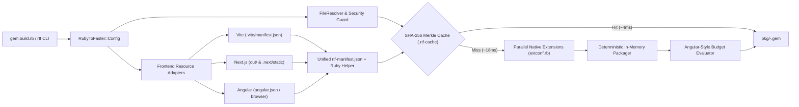

# RubyToFaster (`rtf`)

[](https://github.com/HNMLabs/rubytofaster/actions/workflows/ci.yml)
[](https://www.ruby-lang.org/)
[](#why-rubytofaster)
[](LICENSE)
[](https://github.com/HNMLabs/rubytofaster/wiki)

**RubyToFaster** (`rtf`) is a minimalist, high-speed build system for Ruby gems that executes the package compiler directly as a lightweight script—incorporating architecture and first-class frontend resource pipelines from **Angular**, **Vite**, and **Next.js**.

Instead of booting heavy task runners, spawning repeated `git` subshells, or writing brittle glue scripts to bundle modern web UIs into Ruby gems (Rails engines, Rack dashboards, admin panels, developer tools), `RubyToFaster` compiles deterministic, RubyGems-compliant `.gem` archives in **single-digit to low-double-digit milliseconds**.

---

## Why RubyToFaster?

| Capability | Traditional `rake build` / `gem build` | **RubyToFaster (`rtf`)** |
| :--- | :--- | :--- |
| **Execution Model** | Requires `Rakefile` + `Bundler::GemHelper` | Runs directly as a standalone Ruby script (`gem.build.rb`) or `rtf` CLI |
| **Runtime Dependencies** | Rake, Bundler, external task gems | **Zero** external runtime dependencies (pure Ruby 3.0+ stdlib) |
| **Incremental Caching** | Rebuilds `.gem` unconditionally | Content-addressable SHA-256 **Merkle cache** (`.rtf-cache/`) — **~4ms** cache hits |
| **Packaging Engine** | Disk-bound file stats & non-sorted tar | **In-memory deterministic** `TarWriter` + `Gzip` (`SOURCE_DATE_EPOCH`, sorted entries) |
| **Frontend Resources** | Manual Rake hooks & fragile copy tasks | Native adapters for **Vite**, **Next.js**, and **Angular** + Ruby helper codegen |
| **Size Governance** | None | **Angular-inspired bundle budgets** (`max_compressed_kb`, `max_unpacked_kb`, `max_entry_kb`) |
| **Extensibility** | Imperative Rake prerequisites | **Vite/Rollup-inspired plugin hooks** (`before_resolve`, `transform`, `generate_bundle`, `after_package`) |
| **Supply-Chain Security** | Packages whatever matches `spec.files` | Built-in path-traversal guard, symlink jail, array-only subprocesses, `.env`/key pruning |

---

## Architecture Overview



---

## Installation

Add `rubytofaster` to your `Gemfile` (development group) or install it directly:

```bash
gem install rubytofaster
```

Or build from source using `RubyToFaster` itself (self-hosted dogfooding):

```bash
git clone https://github.com/HNMLabs/rubytofaster.git
cd rubytofaster
./gem.build.rb
gem install --local pkg/rubytofaster-0.1.0.gem
```

---

## Quick Start

### 1. Minimalist 1-Line Autorun Script

Create `gem.build.rb` and run `ruby gem.build.rb`:

```ruby
#!/usr/bin/env ruby
require "rubytofaster/autorun"
```

`RubyToFaster` automatically discovers your `*.gemspec`, detects any prebuilt Vite, Next.js, or Angular bundles, prunes dev caches and secrets, caches the Merkle digest in `.rtf-cache/`, and writes `pkg/<name>-<version>.gem`.

### 2. Declarative Compiler Script (`gem.build.rb`)

Scaffold a script with `rtf init` (or `rtf init --vite --nextjs --angular`):

```ruby
#!/usr/bin/env ruby
# frozen_string_literal: true

require "rubytofaster"

RubyToFaster.build do |pkg|
  pkg.gemspec "my_gem.gemspec"
  pkg.incremental  = true
  pkg.reproducible = true

  # Enforce Angular-style package size budgets
  pkg.budget max_compressed_kb: 512, max_unpacked_kb: 2048
end
```

Run it directly as an executable script:

```bash
chmod +x gem.build.rb
./gem.build.rb
```

Example terminal output:

```text
RubyToFaster v0.1.0 [BUILT] rubytofaster (0.1.0)
  Artifact   : /path/to/pkg/rubytofaster-0.1.0.gem
  Size       : 25.00 KB compressed / 78.22 KB unpacked (24 files, 0 pruned)
  SHA-256    : f93fe0fa203ab1d2982c8e488fcfdc74efa11dfc439cb378df363442350548a4
  Done in 17.86ms
```

Re-running with no changes hits the content-addressable Merkle cache:

```text
RubyToFaster v0.1.0 [CACHE HIT] rubytofaster (0.1.0)
  Artifact   : /path/to/pkg/rubytofaster-0.1.0.gem
  Size       : 25.00 KB compressed / 78.22 KB unpacked (24 files, 0 pruned)
  SHA-256    : f93fe0fa203ab1d2982c8e488fcfdc74efa11dfc439cb378df363442350548a4
  Done in 4.66ms
```

### 3. Single-File Inline Gem (No `.gemspec` File Needed)

For ultra-minimalist micro-gems and internal tools, define your entire specification inside the build script:

```ruby
#!/usr/bin/env ruby
# frozen_string_literal: true

require "rubytofaster"

RubyToFaster.build do |pkg|
  pkg.spec do |s|
    s.name    = "fast_token"
    s.version = "1.0.0"
    s.summary = "Zero-boilerplate micro-gem built from a single script"
    s.authors = ["HNM Labs"]
    s.license = "MIT"
    s.files   = Dir.glob("lib/**/*.rb")
  end
end
```

---

## Incorporating Angular, Vite, and Next.js Resources

Modern Ruby gems—such as observability dashboards, background job UIs, admin panels, and Rails Engines—often ship precompiled frontend applications. `RubyToFaster` natively understands **Vite**, **Next.js**, and **Angular** build outputs, strips gigabytes of bundler cache bloat (`node_modules/`, `.next/cache/`, `.angular/cache/`, `.map` files), stages hashed assets into your `.gem` in-memory, and generates a **zero-dependency Ruby asset resolver** so host apps never need Node.js installed in production.

```ruby
#!/usr/bin/env ruby
# frozen_string_literal: true

require "rubytofaster"

RubyToFaster.build do |pkg|
  pkg.gemspec "pulse_dashboard.gemspec"

  # 1. Vite (parses dist/.vite/manifest.json & stages hashed ESM/CSS chunks)
  pkg.vite(
    root: "ui/widgets",
    out_dir: "dist",
    mount_to: "public/pulse/vite",
    auto_build: true
  )

  # 2. Next.js (supports `output: 'export'` in out/ OR `.next/static` + build-manifest.json)
  pkg.nextjs(
    root: "ui/portal",
    mode: :auto,
    mount_to: "public/pulse/nextjs",
    auto_build: true
  )

  # 3. Angular (parses angular.json Architect workspaces & v17+ `browser/` application bundles)
  pkg.angular(
    root: "ui/admin",
    project: "admin-console",
    mount_to: "public/pulse/angular",
    auto_build: true
  )

  # Generate a standalone Ruby module inside the gem for runtime asset resolution!
  pkg.generate_asset_helper(
    module_name: "PulseDashboard::Assets",
    path: "lib/pulse_dashboard/assets.rb"
  )

  pkg.budget max_compressed_kb: 1536, max_unpacked_kb: 6144
end
```

### Consuming Staged Assets in Ruby / Rack / Rails

Inside your gem's Rack app or Rails Engine view, call the generated module—no Node.js, Vite dev server, or external JSON file I/O required at runtime:

```ruby
require "pulse_dashboard/assets"

# Resolve hashed chunk paths directly:
PulseDashboard::Assets.asset_path("src/main.ts", framework: :vite)
# => "assets/main-8f91a.js"

PulseDashboard::Assets.asset_path("/dashboard", framework: :nextjs)
# => "_next/static/chunks/main-abc.js"

PulseDashboard::Assets.asset_path("index", framework: :angular)
# => "main-AA99.js"

# Emit ready-to-render <link rel="stylesheet"> and <script type="module"> tags:
PulseDashboard::Assets.html_tags("src/main.ts", framework: :vite, url_prefix: "/pulse/vite")
# => <link rel="stylesheet" href="/pulse/vite/assets/main-12b3c.css">
#    <script type="module" src="/pulse/vite/assets/main-8f91a.js"></script>
```

---

## Plugin Pipeline & In-Memory Transforms

Inspired by Vite and Rollup, `RubyToFaster` supports clean lifecycle hooks that transform files **in-memory** during tar stream creation without mutating working-tree files on disk:

```ruby
RubyToFaster.build do |pkg|
  pkg.gemspec "my_gem.gemspec"

  pkg.before_resolve do |config|
    # Pre-build validation or dynamic configuration
  end

  pkg.transform do |gem_path, content|
    if gem_path == "lib/my_gem/build_info.rb"
      content.gsub("__GIT_SHA__", ENV.fetch("GITHUB_SHA", "dev"))
    end
  end

  pkg.after_package do |result|
    puts "Built #{result.gem_path} (SHA-256: #{result.gem_sha256})"
  end
end
```

---

## CLI Reference (`rtf` / `rubytofaster`)

Both `rubytofaster` and the concise `rtf` alias are installed:

```bash
# Build using gem.build.rb or *.gemspec in current directory
rtf build

# Bypass incremental Merkle cache and show per-stage monotonic timings
rtf build --no-cache --verbose

# Output machine-readable JSON build telemetry for CI pipelines
rtf build --json

# Scaffold an executable gem.build.rb compiler script
rtf init --vite --nextjs --angular

# Verify SHA-256/SHA-512 checksums, inspect tar entries, and list embedded frontend manifests
rtf inspect pkg/my_gem-0.1.0.gem

# Watch source files for instant incremental rebuilds
rtf watch

# Diagnose Ruby toolchain, gemspecs, and detected frontend configs
rtf doctor

# Remove .rtf-cache/ and pkg/ artifacts
rtf clean
```

---

## Documentation & Wiki

Full guides and API documentation are available in the **[RubyToFaster GitHub Wiki](https://github.com/HNMLabs/rubytofaster/wiki)**:

- **[Getting Started](https://github.com/HNMLabs/rubytofaster/wiki/Getting-Started)**
- **[Architecture & Compiler Pipeline](https://github.com/HNMLabs/rubytofaster/wiki/Architecture-and-Compiler-Pipeline)**
- **[Frontend Resources: Vite, Next.js & Angular](https://github.com/HNMLabs/rubytofaster/wiki/Frontend-Resources-Vite-Nextjs-Angular)**
- **[CLI & Script API Reference](https://github.com/HNMLabs/rubytofaster/wiki/CLI-and-Script-API-Reference)**
- **[Security & Reproducible Builds](https://github.com/HNMLabs/rubytofaster/wiki/Security-and-Reproducible-Builds)**
- **[Troubleshooting & FAQ](https://github.com/HNMLabs/rubytofaster/wiki/Troubleshooting-and-FAQ)**

---

## Security

Supply-chain safety—including path-traversal protection, symlink containment, shell-injection-free subprocess execution, deterministic `SOURCE_DATE_EPOCH` builds, and automatic secret pruning—is enabled by default. Please review [SECURITY.md](SECURITY.md) for details and vulnerability reporting instructions.

---

## Contributing

Bug reports and pull requests are welcome on GitHub at [HNMLabs/rubytofaster](https://github.com/HNMLabs/rubytofaster). See [CONTRIBUTING.md](CONTRIBUTING.md) for development setup and guidelines.

```bash
rake test        # Run the Minitest suite (with Ruby warnings enabled)
./gem.build.rb   # Build rubytofaster.gem using RubyToFaster itself
```

---

## License

Released under the [MIT License](LICENSE). Copyright (c) 2026 HNM Labs.
