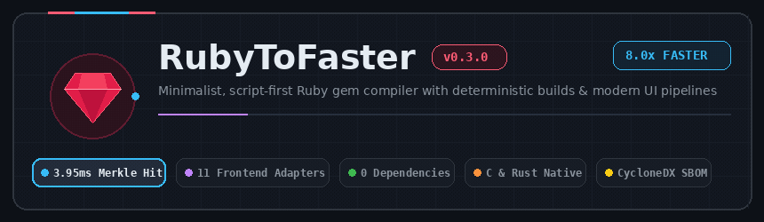
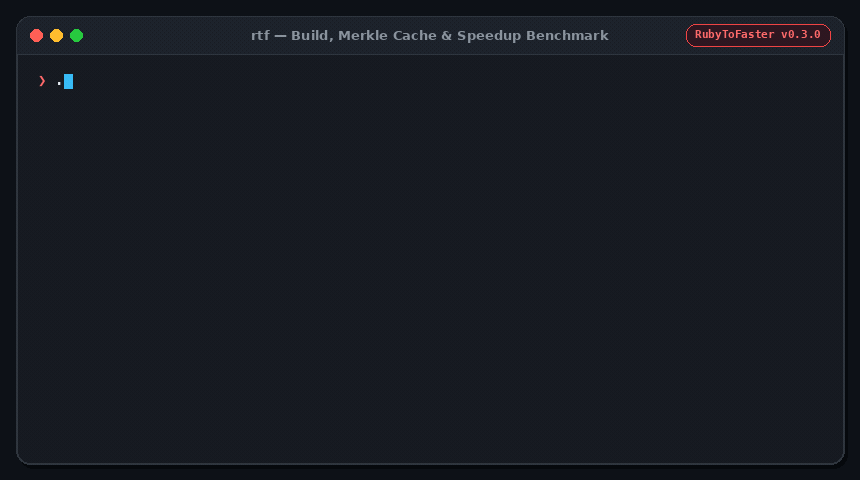
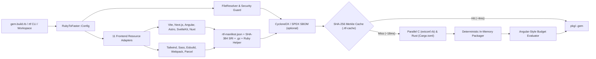
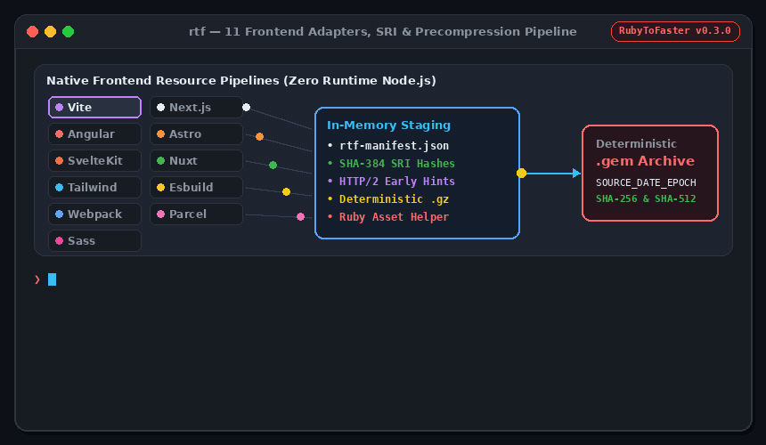
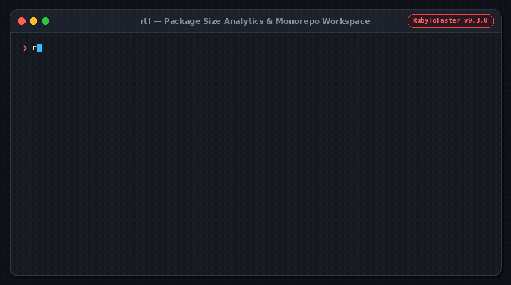
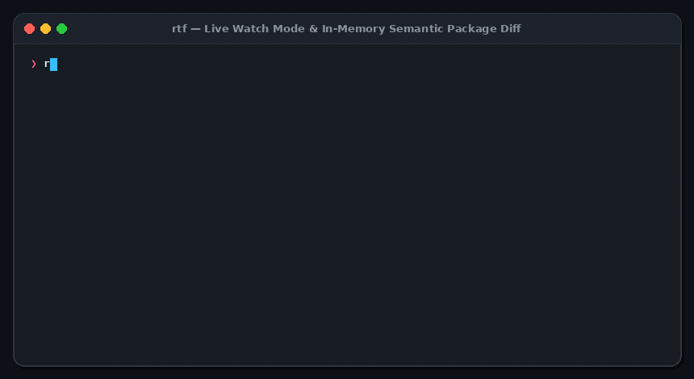

<p align="center">
  
</p>

# RubyToFaster (`rtf`)

[](https://github.com/HNMLabs/rubytofaster/actions/workflows/ci.yml)
[](https://www.ruby-lang.org/)
[](#why-rubytofaster)
[](#incorporating-frontend-resources-11-native-adapters)
[](#supply-chain-security-sbom--reproducibility)
[](LICENSE)
[](https://github.com/HNMLabs/rubytofaster/wiki)

**RubyToFaster** (`rtf`) is a minimalist, high-speed build system for Ruby gems that executes the package compiler directly as a lightweight script—incorporating architecture and first-class resource pipelines for **11 frontend frameworks & bundlers** (**Vite**, **Next.js**, **Angular**, **Astro**, **SvelteKit**, **Nuxt**, **Webpack**, **Parcel**, **Tailwind CSS**, **Sass/SCSS**, and **Esbuild**), parallel **C & Rust** native extensions, **CycloneDX/SPDX SBOM** generation, **monorepo workspaces**, and **bit-for-bit reproducible builds**.

<p align="center">
  
</p>

Instead of booting heavy task runners, spawning repeated `git` subshells, or writing brittle glue scripts to bundle modern web UIs into Ruby gems (Rails engines, Rack dashboards, admin panels, developer tools), `RubyToFaster` compiles deterministic, RubyGems-compliant `.gem` archives in **single-digit to low-double-digit milliseconds**.

---

## Why RubyToFaster?

| Capability | Traditional `rake build` / `gem build` | **RubyToFaster (`rtf`) v0.3.0** |
| :--- | :--- | :--- |
| **Execution Model** | Requires `Rakefile` + `Bundler::GemHelper` | Standalone Ruby script (`gem.build.rb`), `rtf` CLI, or drop-in `RubyToFaster::RakeTask` |
| **Runtime Dependencies** | Rake, Bundler, external task gems | **Zero** external runtime dependencies (pure Ruby 3.0+ stdlib) |
| **Incremental Caching** | Rebuilds `.gem` unconditionally | Content-addressable SHA-256 **Merkle cache** (`.rtf-cache/`) — **~4ms** cache hits (**8x faster**) |
| **Packaging Engine** | Disk-bound file stats & non-sorted tar | **In-memory deterministic** `TarWriter` + configurable `Gzip` (`SOURCE_DATE_EPOCH`, sorted entries) |
| **Frontend Resources** | Manual Rake hooks & fragile copy tasks | **11 native adapters**: Vite, Next.js, Angular, Astro, SvelteKit, Nuxt, Webpack, Parcel, Tailwind, Sass, Esbuild |
| **Asset Runtime & Perf** | Manual asset path wiring | Auto-generated Ruby helpers with **SHA-384 SRI**, **HTTP/2 Early Hints**, and deterministic **`.gz` precompression** |
| **Native Extensions** | Sequential C compilation | Parallel **C/C++ (`extconf.rb`)** and **Rust (`Cargo.toml` / rb-sys / magnus)** verification |
| **Supply-Chain & SBOM** | Packages whatever matches `spec.files` | Path-traversal guard, symlink jail, `.env`/key pruning, **CycloneDX 1.5 & SPDX 2.3 SBOM**, `rtf verify --reproducible` |
| **Monorepo & Analytics** | None | Topological **`rtf workspace`** multi-gem builds & visual **`rtf stats`** size breakdown |
| **Size Governance** | None | **Angular-inspired bundle budgets** (`max_compressed_kb`, `max_unpacked_kb`, `max_entry_kb`) |
| **Extensibility** | Imperative Rake prerequisites | **Vite/Rollup-inspired plugin hooks** (`before_resolve`, `transform`, `generate_bundle`, `after_package`) |

---

## Architecture Overview



---

## Installation

Add `rubytofaster` to your `Gemfile` (development group) or install it directly:

```bash
gem install rubytofaster
```

Or build from source using `RubyToFaster` itself (self-hosted dogfooding):

```bash
git clone https://github.com/HNMLabs/rubytofaster.git
cd rubytofaster
./gem.build.rb
gem install --local pkg/rubytofaster-0.3.0.gem
```

---

## Quick Start

### 1. Minimalist 1-Line Autorun Script

Create `gem.build.rb` and run `ruby gem.build.rb`:

```ruby
#!/usr/bin/env ruby
require "rubytofaster/autorun"
```

`RubyToFaster` automatically discovers your `*.gemspec`, detects any prebuilt frontend bundles, prunes dev caches and secrets, caches the Merkle digest in `.rtf-cache/`, and writes `pkg/<name>-<version>.gem`.

### 2. Declarative Compiler Script (`gem.build.rb`)

Scaffold a script with `rtf init` (supports flags for all 11 adapters, `--precompress`, and `--sbom`):

```ruby
#!/usr/bin/env ruby
# frozen_string_literal: true

require "rubytofaster"

RubyToFaster.build do |pkg|
  pkg.gemspec "my_gem.gemspec"
  pkg.incremental       = true
  pkg.reproducible      = true
  pkg.compression_level = :default # :fast, :default, :best, or 0..9
  pkg.embed_sbom :cyclonedx        # Embed sbom.cdx.json inside the .gem
  pkg.checksums_file    = true     # Also emit pkg/my_gem-<ver>.gem.sha256

  # Enforce Angular-style package size budgets
  pkg.budget max_compressed_kb: 512, max_unpacked_kb: 2048
end
```

Run it directly as an executable script:

```bash
chmod +x gem.build.rb
./gem.build.rb
```

### 3. Single-File Inline Gem (No `.gemspec` File Needed)

For ultra-minimalist micro-gems and internal tools, define your entire specification inside the build script:

```ruby
#!/usr/bin/env ruby
# frozen_string_literal: true

require "rubytofaster"

RubyToFaster.build do |pkg|
  pkg.spec do |s|
    s.name    = "fast_token"
    s.version = "1.0.0"
    s.summary = "Zero-boilerplate micro-gem built from a single script"
    s.authors = ["HNM Labs"]
    s.license = "MIT"
    s.files   = Dir.glob("lib/**/*.rb")
  end
end
```

---

## Incorporating Frontend Resources (11 Native Adapters)

Modern Ruby gems—such as observability dashboards, background job UIs, admin panels, and Rails Engines—often ship precompiled frontend applications. `RubyToFaster` natively understands **11 frontend frameworks and bundlers**, strips gigabytes of cache bloat (`node_modules/`, `.next/cache/`, `.angular/cache/`, `.parcel-cache/`, `.nuxt/`, `.astro/`, `.map`), stages hashed assets in-memory with **SHA-384 Subresource Integrity (SRI)** and optional **deterministic `.gz` precompression**, and generates a **zero-dependency Ruby asset resolver** so host apps never need Node.js in production.

<p align="center">
  
</p>

| Adapter | DSL Method | Auto-Detected Outputs |
| :--- | :--- | :--- |
| **Vite** | `pkg.vite` | `dist/` + `.vite/manifest.json` |
| **Next.js** | `pkg.nextjs` | `out/` static export or `.next/static` + `build-manifest.json` |
| **Angular** | `pkg.angular` | `angular.json` Architect workspace + v17+ `browser/` |
| **Astro** | `pkg.astro` | `dist/` or SSR `dist/client/` + `_astro/` chunks |
| **SvelteKit** | `pkg.sveltekit` | `build/` or `.svelte-kit/output/client/` + `_app/immutable/` |
| **Nuxt** | `pkg.nuxt` | `.output/public/` or `dist/` + `_nuxt/` chunks |
| **Tailwind CSS** | `pkg.tailwind` | Standalone binary / `@tailwindcss/cli` CSS output |
| **Sass / SCSS** | `pkg.sass` | Dart Sass standalone / npm CSS output |
| **Esbuild** | `pkg.esbuild` | `dist/` or `app/assets/builds/` + `metafile.json` |
| **Webpack** | `pkg.webpack` | `dist/` or `public/packs/` + `manifest.json` / `stats.json` |
| **Parcel** | `pkg.parcel` | `dist/` (auto-pruning `.parcel-cache/`) |

```ruby
#!/usr/bin/env ruby
# frozen_string_literal: true

require "rubytofaster"

RubyToFaster.build do |pkg|
  pkg.gemspec "pulse_dashboard.gemspec"

  pkg.vite      root: "ui/widgets",  out_dir: "dist", mount_to: "public/pulse/vite",   auto_build: true
  pkg.nextjs    root: "ui/portal",   mode: :auto,     mount_to: "public/pulse/nextjs", auto_build: true
  pkg.astro     root: "ui/docs",                      mount_to: "public/pulse/astro",  auto_build: true
  pkg.sveltekit root: "ui/charts",                    mount_to: "public/pulse/svelte", auto_build: true
  pkg.nuxt      root: "ui/studio",                    mount_to: "public/pulse/nuxt",   auto_build: true
  pkg.tailwind  input: "src/app.css", output: "dist/tw.css", mount_to: "public/pulse/tw"
  pkg.sass      input: "src/theme.scss", output: "dist/theme.css", mount_to: "public/pulse/sass"

  # Generate deterministic .gz siblings in-memory for Rack/Nginx gzip_static serving
  pkg.precompress_assets true

  # Generate a standalone Ruby module inside the gem for runtime asset resolution + SRI + Early Hints
  pkg.generate_asset_helper(
    module_name: "PulseDashboard::Assets",
    path: "lib/pulse_dashboard/assets.rb"
  )

  pkg.budget max_compressed_kb: 1536, max_unpacked_kb: 6144
end
```

### Consuming Staged Assets in Ruby / Rack / Rails (with SRI & HTTP/2 Early Hints)

```ruby
require "pulse_dashboard/assets"

# Resolve hashed chunk paths directly (no Node.js, no disk JSON I/O):
PulseDashboard::Assets.asset_path("src/main.ts", framework: :vite)
# => "assets/main-8f91a.js"

# Query SHA-384 Subresource Integrity hash:
PulseDashboard::Assets.integrity("src/main.ts", framework: :vite)
# => "sha384-..."

# Emit <link> and <script type="module"> tags WITH SRI attributes:
PulseDashboard::Assets.html_tags("src/main.ts", framework: :vite, url_prefix: "/pulse/vite", sri: true)
# => <link rel="stylesheet" href="/pulse/vite/assets/main-12b3c.css" integrity="sha384-..." crossorigin="anonymous">
#    <script type="module" src="/pulse/vite/assets/main-8f91a.js" integrity="sha384-..." crossorigin="anonymous"></script>

# Emit HTTP 103 Early Hints / HTTP/2 Link preload header:
PulseDashboard::Assets.preload_headers("src/main.ts", framework: :vite, url_prefix: "/pulse/vite")
# => "</pulse/vite/assets/main-12b3c.css>; rel=preload; as=style, </pulse/vite/assets/main-8f91a.js>; rel=modulepreload; as=script"
```

---

## Supply-Chain Security, SBOM & Reproducibility

`RubyToFaster` ships with zero-dependency supply-chain verification tools built directly into the CLI and Ruby API:

<p align="center">
  
</p>

- **`rtf check --strict`**: Audits gemspec metadata, SPDX licenses, secret file leaks (`.env`, `*.pem`, `*.key`, `id_rsa`, `credentials.yml.enc`), world-writable permissions, executable shebangs, and git working-tree cleanliness.
- **`rtf verify --reproducible`**: Executes two completely isolated clean builds without cache and asserts bit-for-bit identical `SHA-256` hashes under `SOURCE_DATE_EPOCH`.
- **`rtf sbom --format cyclonedx|spdx`**: Generates **CycloneDX 1.5** or **SPDX 2.3** JSON Software Bill of Materials with Package URLs (`purl`), runtime/dev dependencies, staged frontend bundles, and SHA-256 digests for every packaged file.

---

## Package Analytics & Monorepo Workspaces

Inspect package composition instantly and orchestrate multi-gem monorepos in topological dependency order:

<p align="center">
  
</p>

```bash
# Visual size breakdown by directory, file extension, compression ratio, and largest files
rtf stats pkg/my_gem-1.0.0.gem [--top 15] [--json]

# Discover & build all gems across gems/*, packages/*, engines/*, plugins/* in topological order
rtf workspace build [--no-cache] [--json]
rtf workspace check [--strict]
rtf workspace clean
```

---

## Plugin Pipeline & In-Memory Transforms

Inspired by Vite and Rollup, `RubyToFaster` supports clean lifecycle hooks that transform files **in-memory** during tar stream creation without mutating working-tree files on disk:

```ruby
RubyToFaster.build do |pkg|
  pkg.gemspec "my_gem.gemspec"

  pkg.before_resolve do |config|
    # Pre-build validation or dynamic configuration
  end

  pkg.transform do |gem_path, content|
    if gem_path == "lib/my_gem/build_info.rb"
      content.gsub("__GIT_SHA__", ENV.fetch("GITHUB_SHA", "dev"))
    end
  end

  pkg.after_package do |result|
    puts "Built #{result.gem_path} (SHA-256: #{result.gem_sha256})"
  end
end
```

---

## CLI Reference (`rtf` / `rubytofaster`)

<p align="center">
  
</p>

Both `rubytofaster` and the concise `rtf` alias are installed:

```bash
# Build using gem.build.rb or *.gemspec in current directory
rtf build [--no-cache] [--precompress] [--sbom cyclonedx|spdx] [--checksums] [--verbose] [--json]

# Build and locally install the gem
rtf install [--prerelease] [--user-install] [--force]

# Deep in-memory semantic diff between two gem archives (or current build vs target)
rtf diff pkg/my_gem-0.2.0.gem pkg/my_gem-0.3.0.gem [--json]

# Audit supply-chain security, SPDX licenses, executables, and git cleanliness
rtf check [--strict] [--json]

# Verify gem checksums, expected SHA-256, or bit-for-bit reproducible builds
rtf verify [pkg/my_gem-0.3.0.gem] [--sha256 HASH] [--reproducible] [--json]

# Generate CycloneDX 1.5 or SPDX 2.3 JSON Software Bill of Materials
rtf sbom [--format cyclonedx|spdx] [-o pkg/bom.cdx.json]

# Visual package size analytics by directory, extension, and top files
rtf stats [pkg/my_gem-0.3.0.gem] [--top 10] [--json]

# Monorepo multi-gem workspace commands (topologically ordered)
rtf workspace [build|check|clean] [--pattern "gems/*"] [--strict] [--json]

# Benchmark RubyToFaster (cold and warm Merkle hits) vs standard gem build
rtf bench [--iterations 5] [--json]

# Scaffold an executable gem.build.rb compiler script with framework pipelines
rtf init --vite --astro --sveltekit --nuxt --tailwind --sass --precompress --sbom

# Verify SHA-256/SHA-512 checksums, inspect tar entries, and list embedded frontend manifests
rtf inspect pkg/my_gem-0.3.0.gem [--json]

# Watch source files for instant incremental rebuilds
rtf watch

# Diagnose Ruby toolchain, C/Rust compilers, package managers, and all 11 frontend frameworks
rtf doctor

# Remove .rtf-cache/ and pkg/ artifacts
rtf clean
```

---

## Rake Integration (`RubyToFaster::RakeTask`)

For projects that maintain a `Rakefile`, `RubyToFaster::RakeTask` provides a pure zero-dependency drop-in replacement for `Bundler::GemHelper.install_tasks`:

```ruby
# Rakefile
require "rubytofaster/rake_task"

RubyToFaster::RakeTask.new do |t|
  t.out_dir     = "pkg"
  t.incremental = true
end
```

Registered tasks:

```bash
rake build        # Build gem with RubyToFaster (Merkle cached)
rake rtf:install  # Build and install gem locally
rake rtf:check    # Audit supply-chain security, licenses, and shebangs
rake rtf:verify   # Verify bit-for-bit reproducible builds
rake rtf:sbom     # Emit CycloneDX 1.5 JSON SBOM
rake rtf:stats    # Display package composition & size analytics
rake rtf:bench    # Benchmark RubyToFaster vs standard gem build
rake rtf:clean    # Clean build artifacts and .rtf-cache/
```

---

## Documentation & Wiki

Full guides and API documentation are available in the **[RubyToFaster GitHub Wiki](https://github.com/HNMLabs/rubytofaster/wiki)**:

- **[Getting Started](https://github.com/HNMLabs/rubytofaster/wiki/Getting-Started)**
- **[Architecture & Compiler Pipeline](https://github.com/HNMLabs/rubytofaster/wiki/Architecture-and-Compiler-Pipeline)**
- **[Frontend Resources: Vite, Next.js & Angular](https://github.com/HNMLabs/rubytofaster/wiki/Frontend-Resources-Vite-Nextjs-Angular)**
- **[CLI & Script API Reference](https://github.com/HNMLabs/rubytofaster/wiki/CLI-and-Script-API-Reference)**
- **[Security & Reproducible Builds](https://github.com/HNMLabs/rubytofaster/wiki/Security-and-Reproducible-Builds)**
- **[Troubleshooting & FAQ](https://github.com/HNMLabs/rubytofaster/wiki/Troubleshooting-and-FAQ)**

---

## Security

Supply-chain safety—including path-traversal protection, symlink containment, shell-injection-free subprocess execution, deterministic `SOURCE_DATE_EPOCH` builds, automatic secret pruning, and CycloneDX/SPDX SBOM generation—is enabled out of the box. Please review [SECURITY.md](SECURITY.md) for details and vulnerability reporting instructions.

---

## Contributing

Bug reports and pull requests are welcome on GitHub at [HNMLabs/rubytofaster](https://github.com/HNMLabs/rubytofaster). See [CONTRIBUTING.md](CONTRIBUTING.md) for development setup and guidelines.

```bash
rake test        # Run the Minitest suite (with Ruby warnings enabled)
./gem.build.rb   # Build rubytofaster.gem using RubyToFaster itself
```

---

## License

Released under the [MIT License](LICENSE). Copyright (c) 2026 HNM Labs.
